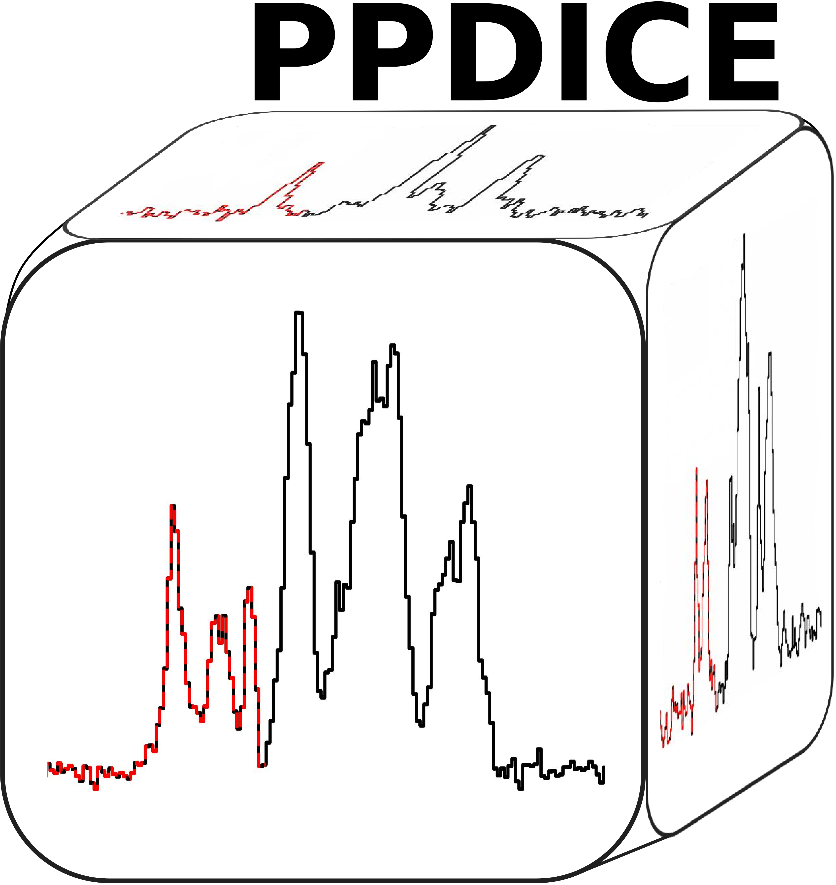

<p align="center">

</p>

About PPDICE
============
<b>P</b>arallelized <b>P</b>ython <b>D</b>iazenylium (N<sub>2</sub>H<sup>+</sup>) <b>I</b>solated <b>C</b>omponent <b>E</b>xtractor 


PPDICE extracts the N<sub>2</sub>H<sup>+</sup> isolated component pixel by pixel in a parallelized approach. The main idea of this code is based on the identification of the intensity valley between the isolated and the main component. 

The code will extract from the most blue-shifted velocities up until the velocity that better matches this valley. One of the products is a datacube only containing the isolated component.

The advantage of extracting the isolated components is that for blended emission, the complexity of the fitting and decomposition of these line profiles is reduced.


Tested with
------------

>   \- [Python](http://www.python.org>) 3.14.8   <br>
>   \- [Astropy](http://www.astropy.org>) 8.0.2  <br>
>   \- [Matplotlib](http://matplotlib.org/) 3.10.9<br>
>   \- [Numpy](http://www.numpy.org) 2.5.3        <br>
>   \- [Scipy](http://www.scipy.org/) 1.18.1      <br>
>   \- [Spectral-cube](https://spectral-cube.readthedocs.io/en/latest/>) 0.7.0


Usage of ``PPDICE``
===================
This code makes use of multiple data-driven parameters which will depend on user's inspection of the datacubes.

Such parameters include the channel range of cloud-free emission, desired SNR threshold to apply the extraction procedure, and V<sub>LSR</sub> of the region. 

__To download and run PPDICE:__

        git clone https://github.com/ralvarezz/PPDICE.git
        cd PPDICE
        python3.14 PPDICE.py (after adapting it accordingly to your data)

Products examples
===================

The code is set up to complete a demo run of the G353.41 ALMA-IMF data. 
Due to [GitHub filesize restrictions](https://docs.github.com/en/repositories/working-with-files/managing-large-files/about-large-files-on-github) we don't provide the fits file along with this repository, but it can be downloaded from the [ALMA-IMF dataverse](https://dataverse.harvard.edu/dataset.xhtml?persistentId=doi:10.7910/DVN/7UPDZJ). 

After placing the fits file inside ``demo/`` you can run the test run of PPDICE, which will save the outputs inside ``G353/``. Currently, the included products don't contain the cubes fits files neither because of this same restriction.


Published work
===================

PPDICE has been used in the following publications:

> \- [ALMA-IMF: XIII. N<sub>2</sub>H<sup>+</sup> kinematic analysis of the intermediate protocluster G353.41](https://ui.adsabs.harvard.edu/abs/2024A%26A...689A..74A/abstract) <br>


Citing ``PPDICE``
===================

If you use PPDICE, please cite the publication where we first described and implemented this approach:

```
@ARTICLE{alvarez24,
       author = {{{\'A}lvarez-Guti{\'e}rrez}, R.~H. and {Stutz}, A.~M. and {Sandoval-Garrido}, N. and {Louvet}, F. and {Motte}, F. and {Galv{\'a}n-Madrid}, R. and {Cunningham}, N. and {Sanhueza}, P. and {Bonfand}, M. and {Bontemps}, S. and {Gusdorf}, A. and {Ginsburg}, A. and {Csengeri}, T. and {Reyes}, S.~D. and {Salinas}, J. and {Baug}, T. and {Bronfman}, L. and {Busquet}, G. and {D{\'\i}az-Gonz{\'a}lez}, D.~J. and {Fernandez-Lopez}, M. and {Guzm{\'a}n}, A. and {Koley}, A. and {Liu}, H.-L. and {Olguin}, F.~A. and {Valeille-Manet}, M. and {Wyrowski}, F.},
        title = "{ALMA-IMF: XIII. N$_{2}$H$^{+}$ kinematic analysis of the intermediate protocluster G353.41}",
      journal = {\aap},
     keywords = {ISM: clouds, ISM: kinematics and dynamics, ISM: molecules, ISM: structure, Astrophysics - Astrophysics of Galaxies},
         year = 2024,
        month = sep,
       volume = {689},
          eid = {A74},
        pages = {A74},
          doi = {10.1051/0004-6361/202450321},
archivePrefix = {arXiv},
       eprint = {2404.07363},
 primaryClass = {astro-ph.GA},
       adsurl = {https://ui.adsabs.harvard.edu/abs/2024A&A...689A..74A},
      adsnote = {Provided by the SAO/NASA Astrophysics Data System}
}


```

Notes
----------
This code and approach should be able to be adapted to any line emission that presents a clear intensity valley between components.

This code was developed by [Rodrigo H. Álvarez-Gutiérrez](https://rodrigoalvarez.space/). 

README inspired on [acorns](https://github.com/jdhenshaw/acorns/blob/master/README.md).


